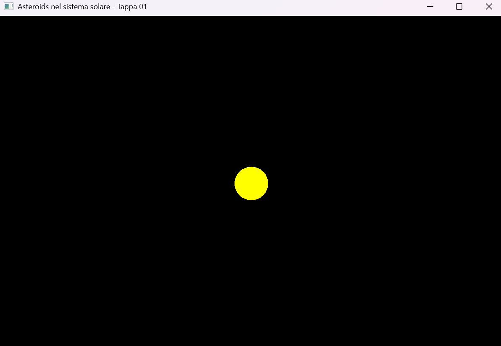
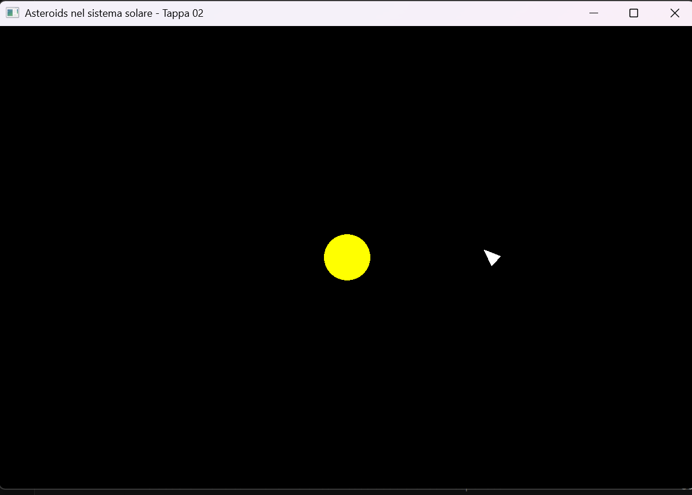
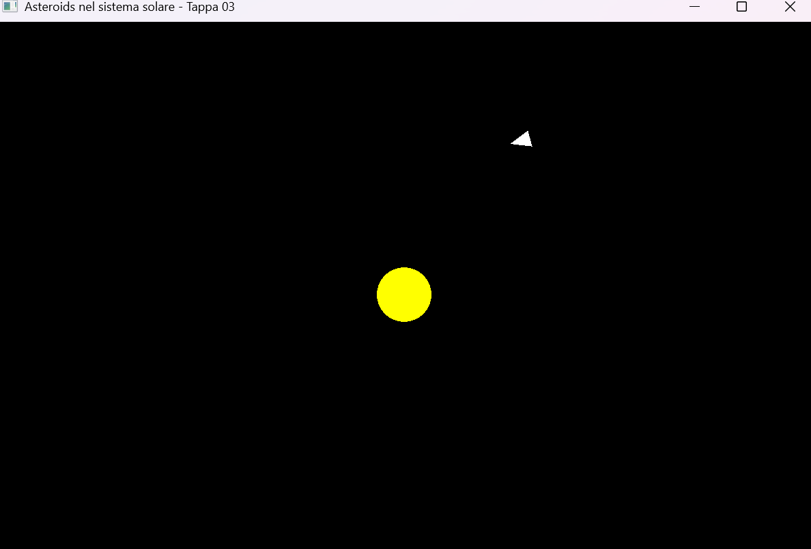
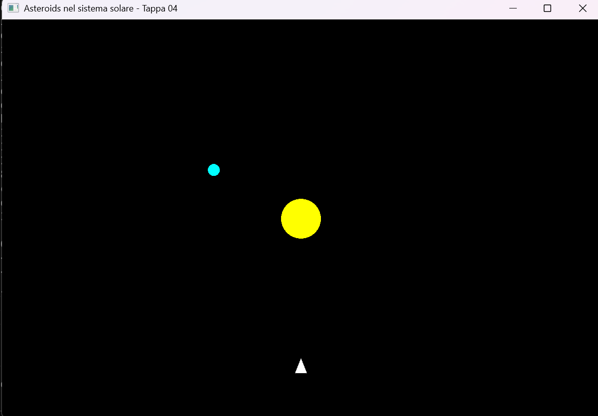
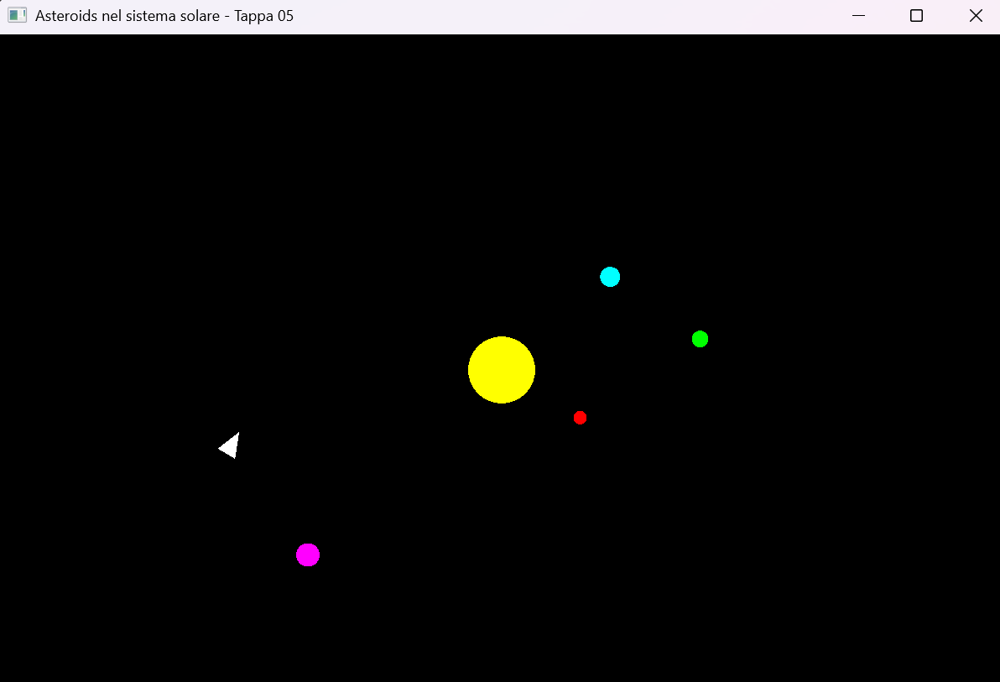
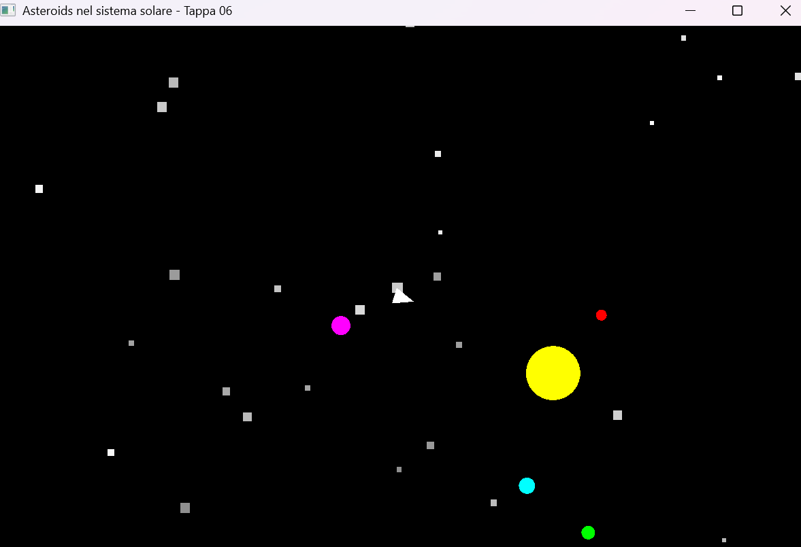
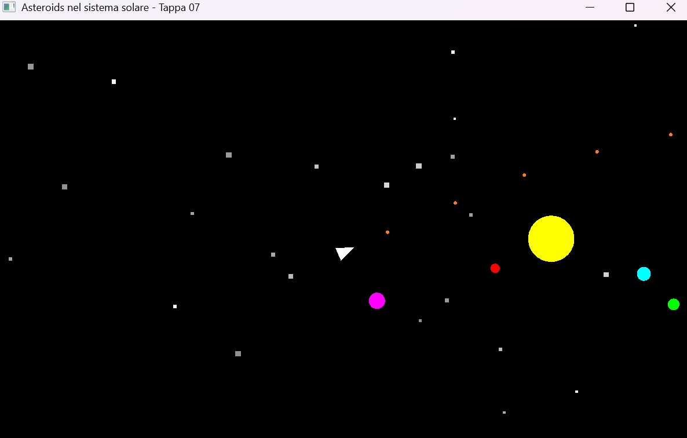
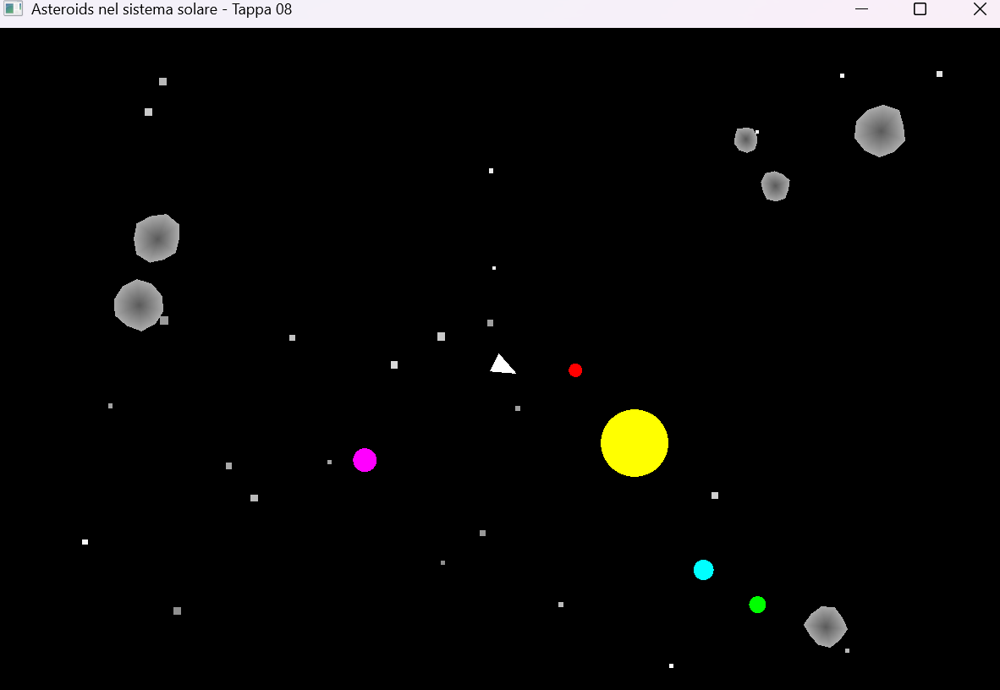
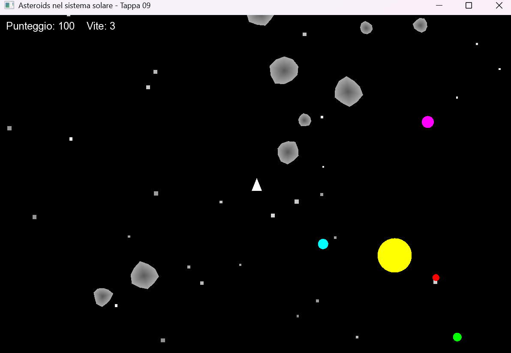
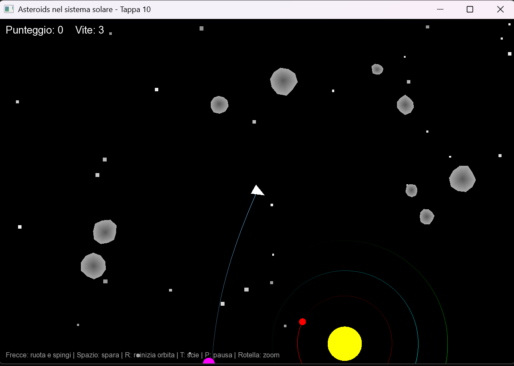

# Relazione: Asteroids nel sistema solare

**Studente:** [Nome Cognome], matricola [numero]
**Esame:** Fondamenti di Computer Grafica
**Tecnologie:** C++17, SFML 3.0.2, CMake (grafica 2D)
**Repository:** [link al repository GitHub]

---

## 1. Cosa si propone di fare il progetto

Il progetto è un gioco 2D che unisce due idee: un gioco in stile _Asteroids_ e una
simulazione di un sistema solare con gravità.

Il giocatore pilota una navicella in un sistema solare. Un Sole al centro attira con la
gravità pianeti, asteroidi, proiettili e la navicella stessa. Gli asteroidi orbitano
attorno al Sole e si possono distruggere sparando: i più grandi si spezzano in due pezzi
più piccoli. Ci sono punteggio, tre vite, una camera che segue la navicella con zoom e
le scie orbitali dei corpi.

Il lavoro è diviso in **10 tappe**. Ogni tappa è una cartella (`Tappa01` ... `Tappa10`)
con il suo `main.cpp`, compila da sola e aggiunge una sola novità alla precedente.
Il progetto si compila e si usa come descritto nel `README.md`.

## 2. Le tappe

Gli screenshot sono nella cartella `screenshot/`.

### Tappa 01: finestra e Sole

**Cosa aggiunge:** una finestra 1200x800 con un cerchio giallo, il Sole, al centro.
Si chiude con la X o con Esc.

**Come funziona:** il cerchio ha l'origine (`setOrigin`) nel suo centro, così la
posizione che gli assegniamo è quella del centro e non dell'angolo in alto a sinistra.

### Tappa 02: navicella che ruota

**Cosa aggiunge:** una navicella a forma di triangolo che ruota con le frecce sinistra e destra.

**Come funziona:** i tre punti del triangolo sono definiti attorno all'origine (0,0), quindi
la rotazione avviene attorno al centro della navicella. Compare il **delta time** (`dt`):
il tempo trascorso dall'ultimo frame, misurato con `sf::Clock`. La rotazione è
`180 gradi/s * dt`, quindi la velocità non dipende dal framerate.

### Tappa 03: spinta e inerzia

**Cosa aggiunge:** la freccia su accelera la navicella nella direzione in cui punta. Se
si rilascia il tasto, la navicella continua a muoversi (inerzia). Ai bordi dello schermo
rientra dal lato opposto (provvisorio).

**Come funziona:** la velocità è un vettore 2D. Con rotazione `a` la direzione di
puntamento è `(sin a, -cos a)`. A ogni frame: `velocità += direzione * accelerazione * dt`
e poi `posizione += velocità * dt` (integrazione di Eulero).

### Tappa 04: gravità e primo pianeta

**Cosa aggiunge:** un pianeta che orbita attorno al Sole.

**Come funziona:** l'accelerazione verso il Sole è `GM / r²`, diretta lungo il vettore che
va dal corpo al Sole (normalizzato). La massa del corpo che cade si semplifica, quindi
la stessa formula vale per tutti. Per un'orbita circolare la velocità iniziale è
perpendicolare al raggio e vale `sqrt(GM / r)`. Cambiando questa velocità si ottengono
orbite ellittiche, la caduta nel Sole o la fuga.

### Tappa 05: più pianeti e gravità sulla navicella

**Cosa aggiunge:** quattro pianeti a distanze diverse. La gravità agisce anche sulla
navicella, che parte in orbita. Il tasto R la riporta in orbita.

**Come funziona:** i dati di un pianeta sono raccolti in una `struct` e i pianeti stanno
in un `std::vector`, quindi lo stesso ciclo `for` li aggiorna tutti. Una funzione
`creaPianeta` calcola posizione e velocità iniziale per un'orbita circolare.

### Tappa 06: camera e zoom

**Cosa aggiunge:** una camera (`sf::View`) che segue la navicella e uno zoom con la
rotella del mouse. Compare uno sfondo di stelle. Il rientro dai bordi è stato tolto,
perché il mondo non ha più limiti.

**Come funziona:** gli oggetti restano in coordinate del **mondo**. La `View` decide quale
parte del mondo si vede nella finestra: muoverla significa cambiarne il centro, e lo zoom
significa cambiarne la dimensione. Le stelle sono 2000 quadratini (due triangoli ciascuno)
in un solo `VertexArray`.

### Tappa 07: proiettili

**Cosa aggiunge:** la barra spaziatrice spara dalla punta della navicella.

**Come funziona:** ogni proiettile ha forma, velocità e un tempo di vita (2 secondi). La sua
velocità è quella della navicella più quella dello sparo (500). Un timer limita la
frequenza a un colpo ogni 0,25 secondi. Anche i proiettili sono attirati dal Sole. I
proiettili scaduti si eliminano con l'idioma `erase`-`remove_if`.

### Tappa 08: asteroidi e collisioni

**Cosa aggiunge:** 20 asteroidi che orbitano attorno al Sole. Un proiettile che ne colpisce
uno lo distrugge. Se uno colpisce la navicella o il Sole, la navicella torna in orbita.

**Come funziona:**

- Ogni asteroide è un poligono irregolare a 10 vertici (raggi casuali), disegnato come
  `TriangleFan`. I vertici sono in coordinate **locali** attorno a (0,0). Posizione e
  rotazione sono dati a parte e si applicano al disegno con una `sf::Transform`:
  prima `translate` e poi `rotate`.
- Le collisioni sono **cerchio contro cerchio**: due cerchi si toccano se la distanza tra
  i centri è minore della somma dei raggi. Si confrontano i quadrati delle distanze per
  evitare la radice quadrata.

### Tappa 09: frammenti, punteggio, vite e testo

**Cosa aggiunge:** gli asteroidi grandi si spezzano in due frammenti. Ci sono punteggio
(20, 50 o 100 punti a seconda della dimensione), tre vite e una schermata di game over, da
cui si riparte con Invio. Dopo una perdita la navicella lampeggia ed è invulnerabile per
2 secondi.

**Come funziona:** il frammento ha raggio pari a 0,6 volte quello della madre e una
velocità uguale a quella della madre più una componente perpendicolare, con segno opposto
per i due pezzi. Il testo usa `sf::Text` con un font caricato da `risorse/Font/`.
Il testo si disegna con la vista di default della finestra, per restare fermo sullo
schermo mentre la camera si muove.

### Tappa 10: scie orbitali, pausa e rifiniture

**Cosa aggiunge:** una scia che sfuma dietro ai pianeti e alla navicella (tasto T per
attivarla o disattivarla), la pausa (tasto P) e una riga di aiuto con i comandi.

**Come funziona:** ogni corpo conserva le sue ultime posizioni in una `std::deque`, una
ogni 50 ms. La scia è una linea spezzata (`LineStrip`) in cui l'opacità cresce dal punto
più vecchio al più recente: SFML interpola il colore tra i vertici e la coda sfuma. La
pausa pone `dt = 0`, quindi tutta la simulazione si ferma.

## 3. Problemi incontrati

- **Ambiente di sviluppo.** CMake non trovava nessun compilatore finché non ho installato
  Visual Studio con il carico di lavoro "Sviluppo di applicazioni desktop con C++"
  (Visual Studio Code è solo un editor e non basta). Ho dovuto anche usare il template
  giusto: il template dei laboratori richiede CMake 4.0 o più recente.
- **Stelle poco visibili.** Con `PrimitiveType::Points` le stelle erano punti di un pixel e
  non si vedevano. Le ho sostituite con piccoli quadrati fatti di due triangoli, in
  coordinate del mondo, con luminosità e dimensione casuali.
- **Font non trovato.** Il font si carica con un percorso relativo, ma la cartella da cui si
  lancia l'eseguibile cambia (radice del progetto, `build`, `build/Debug`). Il programma
  prova più percorsi relativi e, se non trova il font, stampa un messaggio chiaro.
- **Git.** Per un errore di battitura in un comando CMake è comparsa una cartella di
  compilazione non prevista, che `.gitignore` non copriva, e Git stava per aggiungerla al
  repository. L'ho cancellata, ho completato `.gitignore` e controllato con
  `git status --short` che il repository contenga solo i sorgenti e le risorse.

## 4. Soluzioni tecniche

- **Delta time.** Ogni movimento è moltiplicato per `dt`, quindi non dipende dal
  framerate. `dt` è limitato a 50 ms, così un frame molto lungo (per esempio quando si
  trascina la finestra) non fa fare alla simulazione un salto enorme.
- **Eulero semi-implicito.** Per i corpi in orbita si aggiorna prima la velocità e poi la
  posizione con la velocità nuova. Aggiornando prima la posizione con la velocità vecchia,
  l'orbita guadagnerebbe energia a ogni giro e si allargherebbe a spirale.
- **Distanza minima nella gravità.** La forza usa `max(r, 25)`: vicino al Sole non cresce
  all'infinito e non lancia i corpi a velocità assurde.
- **Coordinate locali e trasformazioni.** Gli asteroidi sono definiti attorno all'origine e
  collocati nel mondo con una `sf::Transform`. L'ordine conta: ruotare prima e traslare
  dopo fa girare l'asteroide su se stesso, mentre l'ordine inverso lo farebbe girare
  attorno all'origine del mondo.
- **Due sistemi di riferimento.** Il mondo si disegna con la `View` della camera e
  l'interfaccia con la vista di default della finestra.
- **Aggiungere e togliere elementi.** Gli elementi distrutti si marcano e si rimuovono alla
  fine con `erase`-`remove_if`. I frammenti nuovi si raccolgono in un vettore a parte e si
  aggiungono dopo i cicli, perché non si inseriscono elementi in un `std::vector` mentre lo
  si scorre.

## 5. Codice e risorse non sviluppati autonomamente

- **Template CMake:** il file `CMakeLists.txt` deriva da quello del Laboratorio 3 fornito
  dai docenti (scarica SFML 3.0.2 con `FetchContent`). Ho tolto i target dei laboratori e
  aggiunto un target per ogni tappa.
- **Libreria SFML 3.0.2:** scaricata automaticamente da CMake.
- **Font `Arial.ttf`:** [indicare l'origine: materiali del corso dei docenti, oppure altro].
- **Intelligenza artificiale:** il codice di tutte le tappe è stato scritto con l'assistenza
  di **Claude** (Anthropic), in una conversazione in cui ho chiesto di costruire il
  progetto una tappa alla volta e di spiegarmi i concetti. Io ho creato la struttura del
  repository, compilato, provato ogni tappa, fatto gli screenshot, e ho studiato il codice
  per poterlo spiegare. Anche i consigli per la struttura del progetto, per la relazione e
  per l'uso di Git vengono da Claude.
- **Formule:** la legge di gravitazione di Newton e la velocità dell'orbita circolare sono
  formule standard di fisica. Le slide del corso (lezioni 01 e 02) sono la base teorica
  per la gestione degli eventi, le coordinate, le trasformazioni e le viste.
- Non ho usato altro codice, tutorial, immagini o asset esterni.
